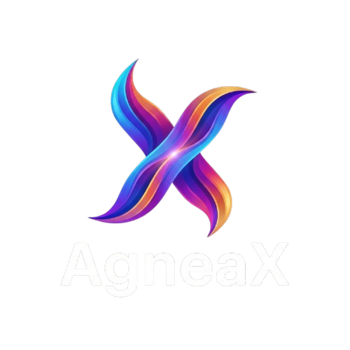

<p align="center">
  
</p>

<h1 align="center">AgneaX OS 1.0</h1>

<p align="center">
  <b>Your desktop, reforged in cyan fire. 🔥</b><br>
  <i>Fast like a spark. Elegant like glass. Built to feel alive.</i>
</p>

<p align="center">
  <a href="https://github.com/agneax/AgneaxOS/releases"></a>
  <a href="https://github.com/agneax"></a>
  <a href="https://github.com/agneax/agniui"></a>
  <a href="https://calamares.io"></a>
  
  
</p>

---

## 🌌 The Spark

Every operating system starts as an idea. **AgneaX OS** started as a flame.

Born from the Sanskrit word *Agni* (fire), AgneaX is a Linux system forged from the ground up for people who are tired of choosing between *beautiful* and *fast*. It wraps a hand-tailored **AgneaX Desktop Environment** in the declarative **AgniUI Framework**, so every window glows with frosted glass, every click ripples with micro-animations, and every boot feels like switching on something new.

Developer, creator, or just someone who wants a computer that feels *good*: pull up a chair. The fire's already lit.

---

## ⚡ What Makes It Burn Bright

### 🖥️ A Desktop With a Soul

* **AgniUI Design Language**: Frosted glass blur, cyber-cyan highlights that adapt to your mood, deep titanium-dark backdrops, and shadows that give every surface depth.
* **The Intelligent Dock (`agneax-dock`)**: Icons swell as your cursor glides past, windows preview themselves on hover, and the whole thing can vanish when you don't need it.
* **The Living Status Panel (`agneax-statusbar`)**: Little capsules that breathe with your system: Volume, Wi-Fi, Ethernet, Hotspot, Bluetooth, DND and Battery, all at a glance.
* **Control Center (`agneax-settings`)**: Your system's command bridge. Turn your laptop into a Wi-Fi hotspot in a single click, with your own SSID and WPA2 protection.

### 🎨 Apps Built to Be Used, Not Just Installed

* **AgneaX Camera (`agneax-camera`)**: An OpenGL-accelerated webcam studio that never freezes. Capture photos, record video, create.
* **AgneaX Image Viewer (`agneax-imageviewer`)**: Browse photos at speed, play with real-time GPU shader filters, and set a wallpaper without leaving the app.
* **AgneaX Package Installer (`agneax-debinstaller`)**: Double-click a package, watch it install. Simple and secure, powered by QApt.
* **AgneaX Terminal (`agneax-terminal`)**: GPU-accelerated, with AgneaX color profiles and a touch of transparency. Your command line, but make it beautiful.
* **AgneaX Screen Locker (`agneax-screenlocker`)**: Privilege-separated PAM authentication keeps intruders out, while media controls keep your music in.
* **AgneaX File Manager (`agneax-filemanager`)**: Tabs, speed, and colorful folder badges that make your files feel organized, even when they aren't.

### 💿 Dual Boot, Without the Drama

* **Install Alongside Windows**: Calamares gently shrinks your existing partition instead of wiping it. Your Windows stays. AgneaX moves in next door.
* **UEFI *and* BIOS**: Modern GPT machines or legacy MBR veterans, both are welcome.
* **A Boot Menu That Knows Everyone**: Every operating system on your disk is auto-registered into a sleek, high-resolution GRUB menu. No manual config, no guesswork.

---

## 📥 Grab the Flame

The official bootable ISO lives on our GitHub Releases:

| Artifact | Architecture | Download Link |
| :--- | :--- | :--- |
| **AgneaX OS 1.0 ISO** | `x86_64` (64-bit) | [⬇️ Download `agneax_1.0.iso`](https://github.com/agneax/AgneaxOS/releases/latest) |

---

## 🚀 Light It Up: Installation in Two Steps

### Step 1: Forge Your Bootable USB (4 GB minimum)

* **On Windows, with Rufus**:
  1. Open [Rufus](https://rufus.ie).
  2. Pick your USB drive, then hit **SELECT** and choose `agneax_1.0.iso`.
  3. Set Partition Scheme to **GPT** (for UEFI) or **MBR** (for Legacy BIOS).
  4. Click **START** and choose **Write in ISO Image mode** (recommended).

* **On Any Platform, with Ventoy**:
  1. Install [Ventoy](https://www.ventoy.net) on your USB drive.
  2. Drop `agneax_1.0.iso` straight onto it. That's it.

* **On Linux / macOS, with the Terminal**:
  ```bash
  sudo dd if=agneax_1.0.iso of=/dev/sdX bs=4M status=progress oflag=sync
  ```
  *(Swap `/dev/sdX` for your USB drive's identifier, and double-check it. `dd` doesn't forgive.)*

### Step 2: Boot and Begin

1. Plug in the USB and restart your computer.
2. Tap your **Boot Menu Key** (`F12`, `F9`, `F8`, `F11`, or `Esc`) as it wakes up.
3. Select your USB drive, then choose your path:
   - **Start AgneaX OS**: Take it for a spin in a live session. Your hard drive stays untouched.
   - **Install AgneaX OS**: Jump straight into the guided installer.
4. Follow the friendly Calamares steps: pick your language, set your time zone, and choose **"Install Alongside"** (Dual Boot) or **"Erase Disk"** (fresh start). Then sit back and enjoy.

---

## 💻 What Your Machine Needs

| Hardware | Bare Minimum | Where It Shines |
| :--- | :--- | :--- |
| **Processor** | 64-bit Dual-Core 2.0 GHz | Quad-Core 64-bit 2.5 GHz+ |
| **Memory (RAM)** | 2 GB | 4 GB or more |
| **Storage** | 20 GB free disk space | 50 GB+ SSD |
| **Display** | 1024 x 768 resolution | 1920 x 1080 (Full HD) |
| **Firmware** | UEFI or Legacy BIOS | UEFI with 64-bit support |

---

## 📜 License & Credits

* **AgneaX Desktop & System Components**: GPLv3 / LGPLv3 / MIT.
* **Calamares**: GPLv3.
* **Lead Maintainer**: Shivam, together with the AgneaX contributors who keep the fire burning.

<p align="center">
  <b>Built with passion, for the next generation of computing. 🔥</b>
</p>