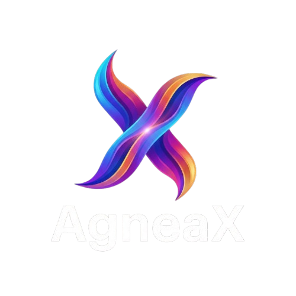

<div align="center">

<p align="center">
  
</p>

# AgneaX OS

### *Your desktop, reforged in cyan fire. Fast like a spark. Elegant like glass.*

[](https://github.com/agneax/AgneaxOS/releases)
[](https://kernel.org)
[](https://kernel.org)
[](https://github.com/agneax)
[](https://github.com/agneax/agniui)
[](https://en.wikipedia.org/wiki/X86-64)
[](LICENSE)

<br/>

**[⚡ Highlights](#-the-four-pillars) • [🎥 Keynote Film](#-official-keynote-launch-film) • [📱 Native Suite](#-native-application-suite) • [💻 Specs](#-system-specifications) • [📥 Get Started](#-get-started-in-3-steps) • [⌨️ Shortcuts](Shortcut-command.md) • [📖 Full Docs](https://github.com/agneax/agneax-os-docs)**

---

</div>

## 🌌 The Spark

Born from the Sanskrit word *Agni* (अग्नि — fire), **AgneaX OS** is an independent, sovereign desktop operating system engineered for people who refuse to compromise between pure aesthetic elegance and raw computing speed.

Built upon a hardened **Linux 6.8 Core** and crowned by our custom **AgniUI Desktop Framework**, AgneaX pairs frosted glass aesthetics and fluid spring animations with sub-millisecond execution.

> *"No clutter. No tracking. No telemetry. Just pure, delightful computing from the first second you power on."*

---

## 🎥 Official Keynote Launch Film

<div align="center">

<a href="https://raw.githubusercontent.com/agneax/agneax-os-docs/main/static/videos/agneax_os_official_trailer.mp4">
  
</a>

### 🎬 [▶️ Watch in English (1080p · 6.7 MB)](https://raw.githubusercontent.com/agneax/agneax-os-docs/main/static/videos/agneax_os_official_trailer_en.mp4) &nbsp;|&nbsp; [▶️ Watch in Hinglish (1080p · 6.8 MB)](https://raw.githubusercontent.com/agneax/agneax-os-docs/main/static/videos/agneax_os_official_trailer.mp4)

*Obsidian stage, kinetic typography, 100% dynamic live screen recordings, future-bass soundtrack, and confident keynote narration.*

</div>

---

## ⚡ The Four Pillars

- **🚀 Blazing Fast & Featherweight:** Idles at under **680 MB RAM** with sub-200ms application startup times powered by our native **AppMotor** runtime engine.
- **🎨 Artisan AgniUI Experience:** Frosted glass blur, fluid parabolic dock magnification, tactile Control Center sliders, and silky **60+ FPS** hardware-accelerated window transitions.
- **🛡️ 100% Sovereign & Private:** Zero background telemetry. Zero tracking. Zero third-party sponsor bloat. Your personal machine belongs strictly to you.
- **📦 Boundless Linux Ecosystem:** Seamless access to over 60,000 applications through our graphical Debian Package Installer, native terminal, `apt`, `snap`, and `flatpak`.

---

## 📱 Native Application Suite

Every everyday utility in AgneaX OS is built natively to share one cohesive visual language:

| Application | Command | Category | Highlights |
|:---|:---|:---|:---|
| 🗂️ **Files** | `agneax-filemanager` | System | Tabbed layout, instant directory switching, spacebar quick look |
| 🖥️ **Terminal** | `agneax-terminal` | System | GPU hardware-accelerated, zero-latency TrueColor text rendering |
| ⚙️ **Settings** | `agneax-settings` | System | Central hub for Wi-Fi hotspot, display modes, and light/dark theme |
| 🧮 **Calculator** | `agneax-calculator` | Utilities | Reactive tactile keypad with instant mathematical evaluation |
| ✍️ **Text Writer** | `agneax-text-writer` | Productivity | Clean distraction-free code and markdown editor with syntax highlighting |
| 📷 **Camera** | `agneax-camera` | Media | OpenGL live webcam studio with tactile shutter feedback |
| 🎬 **Video Player** | `agneax-videoplayer` | Media | Hardware-decoded MP4/MKV video playback with minimalist controls |
| 🖼️ **Image Viewer** | `agneax-imageviewer` | Graphics | GPU shader rendering, rapid zoom, rotate, and 1-click wallpaper setting |
| 📸 **Screenshot** | `agneax-screenshot` | Utilities | Pixel-magnifier loupe, region selection, and instant clipboard copy |
| 📦 **Pkg Installer** | `agneax-debinstaller` | System | 1-click graphical installer for standalone Debian `.deb` packages |
| 🚀 **App Launcher** | `agneax-launcher` | Navigation | Fullscreen blurred backdrop with sub-millisecond keyboard search |

---

## 💻 System Specifications

AgneaX OS runs effortlessly across modern workstations, laptops, and older machines:

| Specification | Minimum Requirement | Recommended for Peak Experience |
|:---|:---|:---|
| **Processor** | 64-bit Dual-Core 2.0 GHz | 64-bit Quad-Core 2.5 GHz or higher |
| **Memory (RAM)** | 2 GB RAM | 4 GB to 8 GB RAM |
| **Storage** | 20 GB free disk space | 40 GB+ NVMe / SSD |
| **Graphics** | OpenGL 3.0 compatible (Intel / AMD / NVIDIA) | Dedicated or modern integrated GPU |
| **Display** | 1024 × 768 resolution | 1920 × 1080 (Full HD) or higher |
| **Installation Media** | 8 GB USB Flash Drive | USB 3.0 Flash Drive |

---

## ⚡ Get Started in 3 Steps

### 1. Download & Verify ISO
Download the official release ISO and verify its cryptographic SHA-256 integrity:

```bash
# Linux / macOS Terminal
sha256sum AgneaX-OS-amd64.iso

# Windows PowerShell
Get-FileHash -Algorithm SHA256 .\AgneaX-OS-amd64.iso
```

### 2. Flash to USB Media
Flash the ISO onto an 8GB+ USB flash drive using your tool of choice:
- **Rufus:** Select ISO → Partition scheme: **GPT** (UEFI) or **MBR** (BIOS) → Write in ISO mode.
- **Ventoy:** Install Ventoy to USB → Copy `AgneaX-OS-amd64.iso` directly to the drive.
- **Balena Etcher:** Select ISO → Select USB → Flash.

### 3. Boot & Experience
Restart your computer, press your motherboard boot menu key (`F12`, `F9`, `F11`, or `Esc`), and select your USB drive:
- **Live Desktop:** Test Wi-Fi, audio, and all native apps in memory without modifying your hard drive.
- **Install AgneaX OS:** Click the desktop installer whenever you're ready for permanent deployment or safe dual-boot alongside Windows.

---

## 📚 Ecosystem & Community

- 📖 **[Comprehensive Documentation](https://github.com/agneax/agneax-os-docs)**: Full user guides, live motion gallery, architecture deep-dives, and troubleshooting.
- ⌨️ **[Keyboard Shortcuts & Command Reference](Shortcut-command.md)**: Master every hotkey, window manager action, and CLI binary.
- 🐛 **[Issue Tracker](https://github.com/agneax/agneax-os-docs/issues)**: Submit bug reports or request new features.
- 💬 **[Community Discussions](https://github.com/agneax/agneax-os-docs/discussions)**: Connect with developers and creators.

---

## 📜 License

AgneaX OS system components, desktop shell, and native utilities are released under the **GNU General Public License v3.0 (GPL-3.0)**. Documentation and media are shared under **Creative Commons Attribution 4.0 (CC BY 4.0)**.

<br/>

<div align="center">

**Built with passion. Forged in fire. Made for everyone. 🔥**

[Download ISO](https://github.com/agneax/AgneaxOS/releases) • [Shortcuts Guide](Shortcut-command.md) • [Full Documentation](https://github.com/agneax/agneax-os-docs)

</div>
